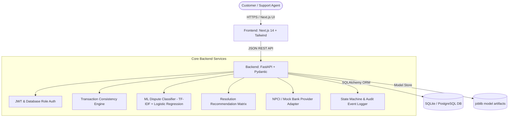

# 🏆 UPIResolve AI (PayRakshak) — Hackathon Presentation & Demonstration Guide

> **Tagline:** *Every transaction explained. Every dispute guided.*

---

## 🏛️ System Architecture

---

## 🔑 Key Features Built

1. **AI-Powered Dispute Classification (`app/ml`)**
   - Natural Language Processing (TF-IDF + Logistic Regression) trained on multi-class UPI dispute categories (`UNAUTHORIZED_TRANSACTION`, `FAILED_TRANSACTION`, `DUPLICATE_PAYMENT`, `INCORRECT_AMOUNT`, `MERCHANT_NON_DELIVERY`, `REFUND_DELAY`, `PENDING_TRANSACTION`).
   - Supports uncertainty threshold abstention (`NEEDS_CLARIFICATION`).

2. **Deterministic Transaction Consistency Engine (`app/services/consistency.py`)**
   - Validates candidate duplicate external references.
   - Detects transaction status vs complaint contradictions.
   - Identifies multi-complaint flags on single transaction IDs.

3. **Advisory Resolution Matrix (`app/services/resolution.py`)**
   - Strict adherence to AGENTS.md non-negotiable rule: **AI recommends; humans decide.**
   - Generates advisory resolutions (`VERIFY_REVERSAL_STATUS`, `REQUEST_DELIVERY_PROOF`, `ESCALATE_UNAUTHORIZED`).

4. **Security & Evidence Handling (`app/routers/disputes.py`)**
   - Magic byte header validation (PNG, JPG, PDF).
   - Strict path traversal guards & max size limits (5 MB).
   - Strict role-based backend authorization for customer/agent scopes.

5. **Alembic DB Migrations & Provider Adapter Interface (`app/services/provider.py`)**
   - Database schema revision control.
   - Standardized provider interface reserving `PROVIDER_VERIFIED` strictly for verified NPCI/banking switch responses.

---

## 📊 Test Verification Summary

- **Backend Pytest Suite:** `24/24` tests passed (`py -m pytest -q`).
- **Frontend Vitest Suite:** `4/4` tests passed (`npm test`).
- **Production Bundle:** `13/13` routes compiled static & dynamic (`npm run build`).

---

## 🚀 Live Demo Credentials

| Role | Email | Password |
|---|---|---|
| **System Administrator** | `admin@rescuelink.com` | `AdminPass1234!` |
| **Demo Customer** | `demo.customer@example.com` | `KCbEAvgJ-YkIVuVb` |
| **Support Agent** | `demo.agent@example.com` | `T1qdLJD9F9rw8rlB` |
