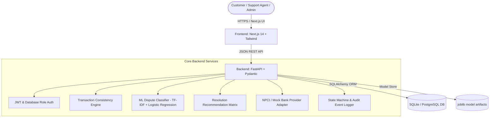

# 🛡️ UPIResolve AI (PayRakshak)

> **Intelligent UPI Dispute Detection & Resolution Platform**
> *Every transaction explained. Every dispute guided.*

[](backend/tests/)
[](frontend/__tests__/)
[](https://nextjs.org/)
[](https://fastapi.tiangolo.com/)

Full-stack fintech UPI dispute detection and resolution management platform built with **FastAPI**, **SQLAlchemy**, **Next.js 14**, and **Tailwind CSS**.

---

## 🏛️ System Architecture



---

## 🔑 Key Features

- 🎨 **Official Corporate Fintech UI with Light / Dark Theme Toggle:**
  - Clean, official design defaulting to **Light Mode** with instant toggle to Dark Mode via header/sidebar controls.
  - Interactive **Dispute Scenario Simulator** on the home page showcasing real-time consistency checks and advisory outcomes.
- 📄 **One-Click Official Dispute Dossier Export (PDF / Print):**
  - Generates comprehensive, audit-ready dispute documentation formatted for submission to the bank ombudsman or NPCI dispute mechanism. Includes case IDs, RRN codes, switch statuses, rule findings, and immutable audit trails.
- 📲 **Bank SMS & WhatsApp Alert Parser:**
  - Fast-track dispute filing by pasting raw bank SMS debit notifications (e.g., *"Rs.1500 debited from A/c... to merchant@upi Ref 123456"*). Automatically extracts disputed amount, reference/RRN, and VPA.
- 🧭 **Guided 5-Step Dispute Filing Wizard:**
  - Interactive multi-step form with step progress indicators, real-time input validation, and optional AI-assisted issue classification (`HELP`).
- ⏱️ **Turnaround SLA Tracker & Analytics Dashboard:**
  - Real-time resolution SLA benchmarked against official **48-hour NPCI turnaround guidelines**, alongside status distributions and rule trigger analytics.
- 🤖 **AI Dispute Classifier (`app/ml`):**
  - Multi-class NLP classification across 7 categories with low-confidence abstention (`NEEDS_CLARIFICATION`).
- ⚡ **Deterministic Consistency Engine (`app/services/consistency.py`):**
  - Real-time checks for duplicate transaction references, status contradictions, and multi-complaint flags.
- 💡 **Explainable Advisory Resolutions (`app/services/resolution.py`):**
  - **AI recommends; humans decide.** Strict `ADVISORY_ONLY` action recommendations.
- 🔒 **Role-Based Access Control & Security:**
  - Server-side database role enforcement (`CUSTOMER`, `SUPPORT_AGENT`, `ADMIN`), magic-byte file validation, and path traversal guards.

---

## ⚙️ Quick Start & Local Setup

### 1. Backend Server Setup

```powershell
cd backend
py -m pip install -r requirements.txt
py -m app.ml.train          # Train ML classifier model
py -m scripts.seed          # Seed synthetic demo data
py -m uvicorn app.main:app --reload
```

### 2. Frontend Setup

```powershell
cd frontend
npm install
npm run dev
```

The frontend runs at **`http://localhost:3000`** and communicates with the FastAPI backend at **`http://localhost:8000`**.

---

## 🧪 Test Suites

### Backend Unit & Integration Tests (Pytest)
```powershell
cd backend
py -m pytest -q
```
*Status:* **24 passed out of 24 tests**

### Frontend Unit Tests (Vitest)
```powershell
cd frontend
npm test
```
*Status:* **4 passed out of 4 tests**

---

## 🔑 Demo Credentials

| Role | Email | Password |
|---|---|---|
| **System Administrator** | `admin@rescuelink.com` | `AdminPass1234!` |
| **Demo Customer** | `demo.customer@example.com` | `KCbEAvgJ-YkIVuVb` |
| **Support Agent** | `demo.agent@example.com` | `T1qdLJD9F9rw8rlB` |

---

## 📜 Handover & Documentation

- [digest.txt](file:///c:/Users/Aditya%20Kulkarni/Downloads/PayRakshak/digest.txt) — Codebase digest, architecture overview, and API route matrix.
- [HACKATHON_DEMO.md](file:///c:/Users/Aditya%20Kulkarni/Downloads/PayRakshak/HACKATHON_DEMO.md) — Hackathon demonstration script and architecture details.
- [AGENTS.md](file:///c:/Users/Aditya%20Kulkarni/Downloads/PayRakshak/AGENTS.md) — Non-negotiable rules and safety constraints.
