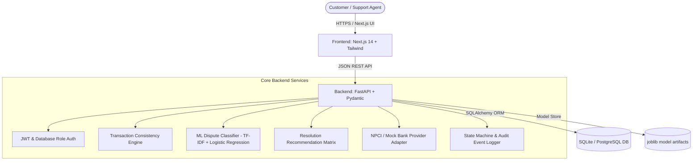

# 🛡️ UPIResolve AI (PayRakshak)

> **Intelligent UPI Dispute Detection & Resolution Platform**
> *Every transaction explained. Every dispute guided.*

[](backend/tests/)
[](frontend/__tests__/)
[](https://nextjs.org/)
[](https://fastapi.tiangolo.com/)

Full-stack fintech UPI dispute detection and resolution management platform built with **FastAPI**, **SQLAlchemy**, **Next.js 14**, and **Tailwind CSS**.

---

## 🏛️ System Architecture



---

## 🔑 Key Features

- 🤖 **AI Dispute Classifier (`app/ml`):** Multi-class NLP classification (`UNAUTHORIZED_TRANSACTION`, `FAILED_TRANSACTION`, `DUPLICATE_PAYMENT`, `INCORRECT_AMOUNT`, `MERCHANT_NON_DELIVERY`, `REFUND_DELAY`, `PENDING_TRANSACTION`) with low-confidence abstention (`NEEDS_CLARIFICATION`).
- ⚡ **Deterministic Consistency Engine (`app/services/consistency.py`):** Real-time detection of duplicate transaction references, status contradictions, and multi-complaint flags.
- 💡 **Explainable Advisory Resolutions (`app/services/resolution.py`):** Non-negotiable rule compliance: **AI recommends; humans decide.** Recommends `ADVISORY_ONLY` actions (`VERIFY_REVERSAL_STATUS`, `REQUEST_DELIVERY_PROOF`, `ESCALATE_UNAUTHORIZED`).
- 🔒 **Role-Based Access Control & Security:** Server-side enforced authorization for `CUSTOMER`, `SUPPORT_AGENT`, and `ADMIN` roles. Magic-byte file validation (PNG, JPG, PDF), path traversal guards, and rate limiting.
- 📈 **Admin Analytics & CSV Export Engine:** Database-backed aggregate metrics and CSV file exports (`/api/v1/admin/export/disputes`, `/api/v1/admin/export/audit-events`).
- 🔄 **Alembic DB Migrations & Provider Adapter:** Database schema revision control and `MockNPCIProviderAdapter` reserving `PROVIDER_VERIFIED` strictly for verified NPCI/bank switch responses.

---

## ⚙️ Quick Start & Local Setup

### 1. Backend Server Setup

```powershell
cd backend
py -m pip install -r requirements.txt
py -m app.ml.train          # Train ML classifier model
py -m scripts.seed          # Seed synthetic demo data
py -m uvicorn app.main:app --reload
```

### 2. Frontend Setup

```powershell
cd frontend
npm install
npm run dev
```

The frontend will run at **`http://localhost:3000`** and connect to the FastAPI backend at **`http://localhost:8000`**.

---

## 🧪 Test Suites

### Backend Unit & Integration Tests (Pytest)
```powershell
cd backend
py -m pytest -q
```
*Status:* **24 passed out of 24 tests**

### Frontend Unit Tests (Vitest)
```powershell
cd frontend
npm test
```
*Status:* **4 passed out of 4 tests**

---

## 🔑 Demo Credentials

| Role | Email | Password |
|---|---|---|
| **System Administrator** | `admin@rescuelink.com` | `AdminPass1234!` |
| **Demo Customer** | `demo.customer@example.com` | `KCbEAvgJ-YkIVuVb` |
| **Support Agent** | `demo.agent@example.com` | `T1qdLJD9F9rw8rlB` |

---

## 📜 Handover & Documentation

- [digest.txt](file:///c:/Users/Aditya%20Kulkarni/Downloads/PayRakshak/digest.txt) — Full codebase digest and API route matrix.
- [HACKATHON_DEMO.md](file:///c:/Users/Aditya%20Kulkarni/Downloads/PayRakshak/HACKATHON_DEMO.md) — Detailed hackathon presentation guide & architecture overview.
- [AGENTS.md](file:///c:/Users/Aditya%20Kulkarni/Downloads/PayRakshak/AGENTS.md) — Non-negotiable architectural rules for coding agents.
